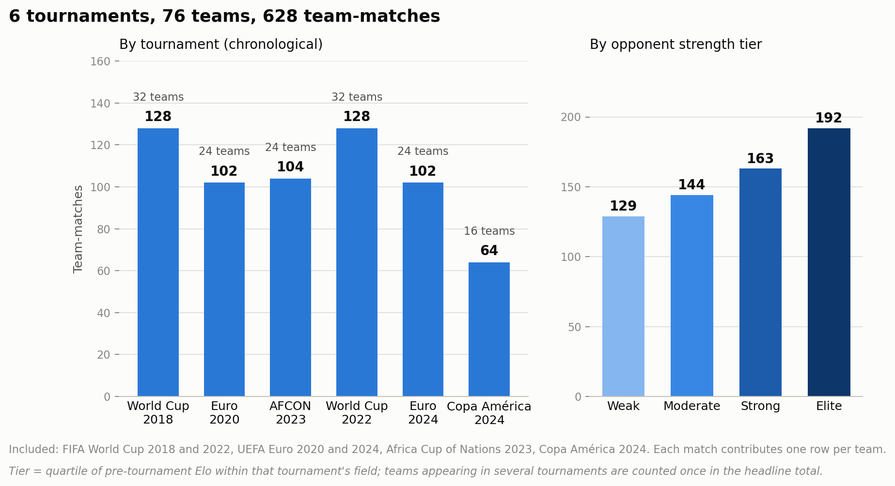
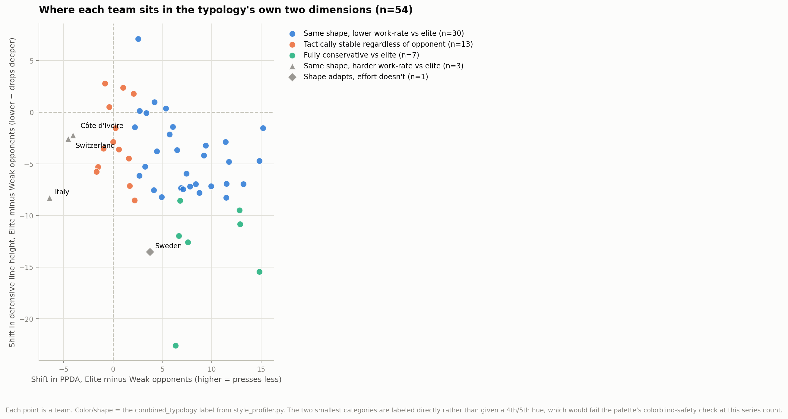
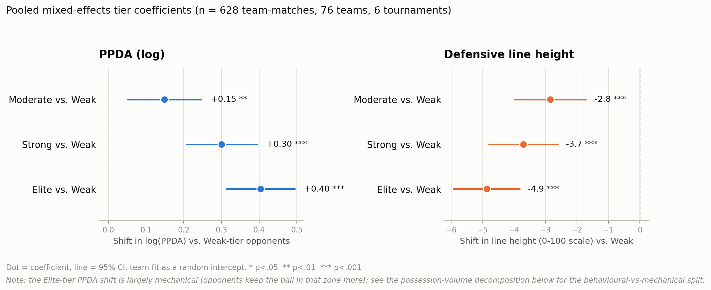
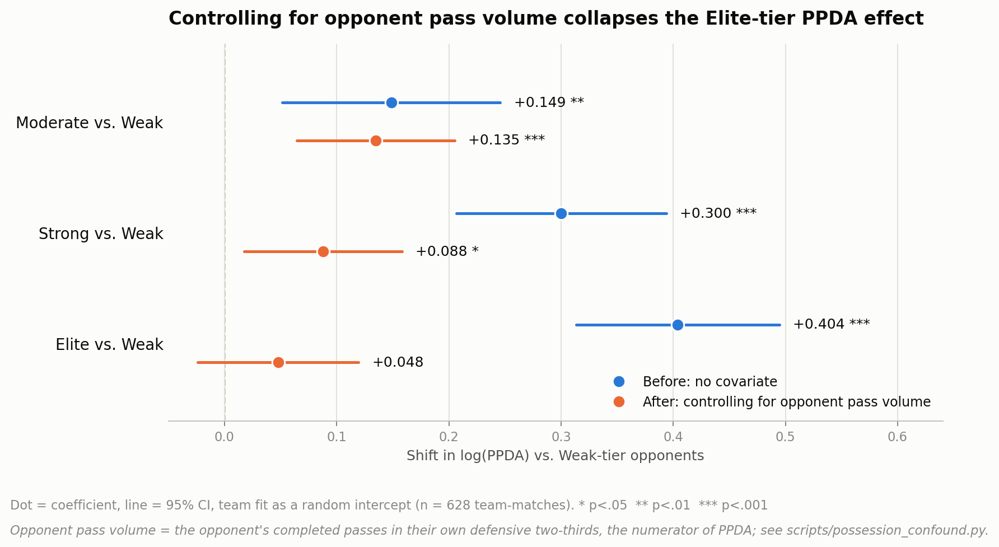
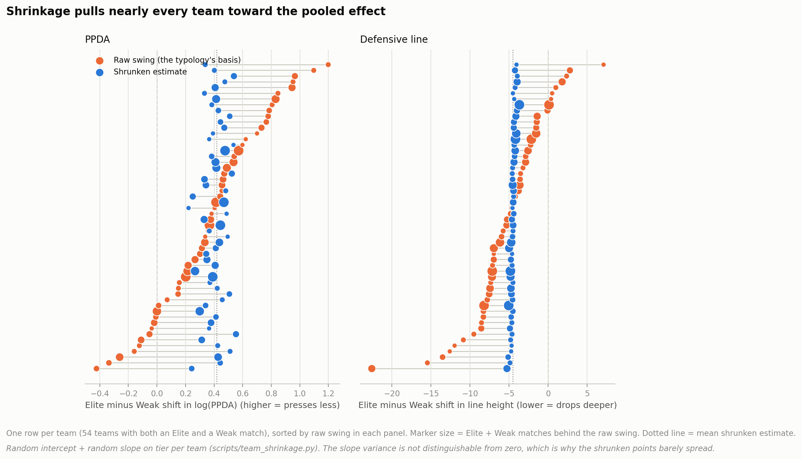

# Team Style Profiler
### Stratified Tactical Tendency Profiling Across International Tournaments
**Ramith Vaid | NTU Singapore | Data Science & Artificial Intelligence**

---

## Overview

A narrative walk-through of the argument, built around the four figures, is in [CASE_STUDY.md](CASE_STUDY.md).

Most tactical analysis treats a team's playing style as a single, fixed number, average PPDA across a tournament, average defensive line height across a season. This project starts from a different premise, suggested directly by Will Thomson (Principal Data Scientist, Leeds United, formerly Head of Soccer Research at StatsBomb): a team's tactical identity often changes depending on the opponent, and that variation is itself the interesting signal.

This project stratifies pressing intensity and defensive line height by opponent strength across six full international tournaments, then classifies each team into a typology describing how its approach shifts, or doesn't, against elite opposition versus weaker sides.

---

## A Methodological Detour Worth Documenting

The original plan was to fit a Dixon-Coles style model to estimate team strength directly from each tournament's results. This failed in an instructive way: with only 64 matches and 32 teams in a single World Cup, the model has roughly one free parameter for every match played. The result was statistically valid but footballingly meaningless, Serbia, Iran, Canada and Costa Rica ranked above Argentina and France, the tournament's eventual finalists.

Rather than force a broken model to look reasonable through more regularisation, the model was abandoned in favour of an established, validated alternative: the World Football Elo Ratings (eloratings.net), built from over 150 years of accumulated match history rather than 64 games in isolation. This produced an immediately sensible ranking, Brazil, Argentina and France at the top of the 2022 World Cup field, Saudi Arabia, Ghana and Cameroon at the bottom, exactly as expected.

This is included here deliberately. Knowing when a custom model is underdetermined, and choosing an established alternative rather than forcing a plausible looking but unstable result, is itself a real piece of analytical judgement.

---

## Pipeline

```
StatsBomb event data  --->  schema_mapper.py (Opta format)  --->  tactical_engine.py
                                                                   (PPDA, defensive line)
                                                                          |
                                                                          v
World Football Elo Ratings  --->  elo_loader.py (pre-tournament strength, by tier)
                                                                          |
                                                                          v
                                                          style_profiler.py
                                              (stratification + combined typology)
```

Six tournaments processed end to end: 2022 and 2018 FIFA World Cups (64 matches each), UEFA Euro 2024 and 2020 (51 matches each), Copa América 2024 (32 matches), and the 2023 Africa Cup of Nations (52 matches). 628 team-match observations in total, across 76 teams, 54 of which have both an Elite and a Weak opponent and so get a combined typology, the rest are labelled "Insufficient data". Running two editions each of the World Cup and the Euros also means a number of teams (Argentina, France, Spain and others) now appear across multiple tournaments rather than just once, which matters for how much the per-team typology below can be trusted, see "Does Opponent Strength Have a Real Effect?".

---

## Methodology

**Opponent strength tiering.** Each team's Elo rating immediately before a tournament's start is pulled from the historical Elo dataset, then classified into a quartile based tier (Elite, Strong, Moderate, Weak) relative to that specific tournament's field. This means strength is always relative to the actual competition a team is in, not a global, context-free number.

**Per-match metrics.** Reusing the PPDA and defensive line height calculations from the Tactical Verdict Engine (with the corrections described below), every team's performance in every match is reduced to two numbers: how aggressively they pressed, and how high their defensive line sat.

**Stratification.** For each team, matches are grouped by opponent strength tier, and each tier's average is compared back to that team's own overall tournament average, not to a generic league average. A 20% swing threshold (relative to the team's own mean) separates a meaningful tactical shift from normal match to match noise.

**Combined typology.** Rather than reporting PPDA and defensive line shifts separately, the two dimensions are crossed into a single descriptive pattern. This is where the more interesting findings emerged.



---

## Key Findings

These replace an earlier set of findings that were computed with a broken PPDA (see "Corrections" below). Re-running the full stratification with the corrected PPDA, and checking each earlier finding against it:

| Earlier finding | With corrected PPDA | Verdict |
|---|---|---|
| Japan, Senegal: compact aggressive block vs elite | Japan "Fully conservative vs elite", Senegal "Shape adapts, effort doesn't". Both have one Elite match, so the Elite figure is a single game (Japan PPDA 29.0 vs elite, 9.0 vs weak) | Disappears |
| Spain, Portugal: compact aggressive block vs elite, at scale | Spain "Same shape, lower work-rate vs elite", Portugal "Fully conservative vs elite". The press direction reversed (PPDA higher vs elite, so less pressing, not more) | Disappears, reversed |
| Uruguay: False High Line risk vs elite | "Tactically stable". The committed code never produced the False High Line label for Uruguay, even before the fix | Disappears (did not reproduce even before the fix) |
| Argentina: tactically stable | "Same shape, lower work-rate vs elite" (PPDA 18.6 vs elite against 12.3 vs weak, defensive line unchanged) | Shifts |
| France, England: same shape, harder work-rate vs elite | Both "Same shape, lower work-rate vs elite". The committed code gave "Tactically stable" for both | Shifts, and reversed |

The table above is the original 3-tournament, 35-team run that caught the PPDA bug; it's left as is since it's a record of that correction, not a live summary. With all six tournaments now in (628 team-matches, 76 teams, 54 with a combined typology, see "Pipeline"), the distribution is 30 "Same shape, lower work-rate vs elite", 13 "Tactically stable", 7 "Fully conservative", 3 "Same shape, harder work-rate" and 1 "Shape adapts, effort doesn't". The dominant pattern is still higher PPDA against elite opponents, and "Does Opponent Strength Have a Real Effect?" below now shows exactly how much of that is genuine pressing behaviour versus the opponent simply having the ball more.



**Per-team typologies are noisier than the pooled effect, but with six tournaments the PPDA ones stop being pure noise.** `scripts/typology_stability.py` shuffles each team's opponent-tier labels across its own matches and re-applies the same 20% rule. On the expanded dataset, 74% of teams are labelled as shifting their press between Elite and Weak opponents, against 61% expected from shuffled tiers (95th percentile 70%), so the real share now clears the shuffled null, a change from the original 3-tournament run (71% vs 66% expected, 95th percentile 77%, not distinguishable from noise then). Defensive line stays indistinguishable from noise either way: 15% against 10% expected (95th percentile 17%). Repeat tournament appearances per team are doing the work here, not just a bigger n; most teams still have one to three matches per tier within any single tournament, so a 20% swing on that alone is still easily a single-match effect. The per-team PPDA typology can now be read as a real, if noisy, signal rather than a coin flip; the per-team defensive-line typology still can't.

---

## Does Opponent Strength Have a Real Effect? A Pooled Mixed-Effects Model



The per-team typology test above is underpowered by design, most teams still have one to three matches per tier within a single tournament, so a single team's 20% swing is close to indistinguishable from noise even where the pooled PPDA signal now clears the shuffled null. The more direct question is whether, pooling all team-matches and letting each team keep its own baseline, pressing intensity and defensive line height move with opponent strength at the population level.

`scripts/mixed_effects_pressing.py` fits two linear mixed-effects models: log(PPDA) and defensive line height, each regressed on opponent tier (Weak as reference) with team fit as a random intercept, so a team with many tournament appearances doesn't outweigh one with few and each team's own general level is absorbed rather than competing with the tier effect. On the full six-tournament dataset (628 team-matches, 76 teams), both effects are real and monotonic, and sharper than on the original three-tournament run. PPDA rises from Weak through Moderate, Strong and Elite (coefficients 0.149, 0.300, 0.404 in log units; p = 0.0027, p < 0.0001, p < 0.0001), meaning PPDA is about 50% higher against Elite opponents than Weak ones on average (exp(0.404) = 1.50). Defensive line height falls the same way, by 2.8, 3.7 and 4.9 units (on the 0-100 pitch scale, roughly 3-5 metres) against Moderate, Strong and Elite opponents respectively (all p < 0.0001). A likelihood-ratio test against a team-only null model confirms opponent tier meaningfully improves the fit for both outcomes, more strongly than before (PPDA: chi2 = 84.0, df = 3, p = 4.2e-18, up from chi2 = 42.4, p = 3.2e-9 on three tournaments; line height: chi2 = 81.6, df = 3, p = 1.4e-17, up from chi2 = 34.7, p = 1.4e-7).

The population-level effect is real and not subtle. It just isn't reliably detectable one team at a time within a single tournament. An intraclass correlation around 0.22-0.24 (most of the variance is match-to-match, not team identity) is exactly the kind of signal that survives pooling but gets swamped by noise in any one team's handful of matches in any one tournament. The defensive line result is a direct physical measure and stands on its own. The PPDA result needs one more step, since PPDA is a ratio and not all of its rise is necessarily genuine pressing behaviour.

### Is the PPDA effect genuine pressing, or just the opponent having the ball more?

PPDA is opponent completed passes (in their own defensive two-thirds) divided by the pressing team's tackles, interceptions and fouls (in the opposition's two-thirds). It rises either because the pressing team does less of the denominator or because the opponent does more of the numerator, and elite sides are expected to do more of the numerator regardless of how hard they're pressed. `scripts/possession_confound.py` reuses the cached match data to pull both counts separately per team-match (`results/ppda_components.csv`) and tests which one opponent tier actually moves.

Opponent tier has a strong, monotonic effect on how many passes the opponent completes in that zone (log(opp_passes) ~ tier: Strong +0.231, Elite +0.380, both p < 0.0001; Moderate +0.028, not significant), confirming elite sides really do have the ball more there. It has a smaller, non-monotonic effect on the pressing team's own raw defensive actions in the opposition's third (log(press_actions) ~ tier: Moderate -0.134 and Strong -0.082, both significant; Elite -0.039, p = 0.24, not significant). Adding opponent pass volume into the PPDA model directly as a covariate confirms the split: the Moderate-tier PPDA effect survives almost unchanged (0.135, p = 0.0002) and the Strong-tier effect shrinks but holds (0.088, p = 0.0145), while the Elite-tier effect collapses from 0.404 to 0.048 and loses significance entirely (p = 0.19).



So the finding isn't uniform across tiers. Against Moderate and Strong opponents, teams do genuinely commit fewer raw defensive actions in the opposition's third, a real, if modest, drop in work-rate. Against Elite opponents specifically, the large PPDA rise is mostly mechanical: elite sides keep the ball in that zone more, and the pressing team's own defensive activity there barely changes. "Teams press less against the best teams" is the wrong headline for the Elite tier; "teams have less of the ball to press against the best teams, and otherwise keep roughly their usual work-rate" is closer to what the data shows. The defensive line result doesn't have this mechanical problem, since line height isn't built from the opponent's output at all. It could still have a different one.

### Is the defensive-line effect just protecting a lead?

A team might sit deep against a strong opponent out of respect for it, or it might simply be protecting a lead, regardless of who it's playing. `scripts/game_state_confound.py` rebuilds the running score for every match from the cached events (goals plus own goals, excluding penalty shoot-out kicks, with time counted as played time including extra time) and uses each team-match's share of time spent leading as a covariate, the same before/after structure as the possession-volume check above (`results/game_state.csv`).

Opponent tier does predict game state: against Moderate, Strong and Elite opponents a team spends 0.077, 0.162 and 0.242 less of the match leading than against Weak ones (p = 0.027, < 0.0001, < 0.0001; raw means 0.375 Weak, 0.295 Moderate, 0.210 Strong, 0.129 Elite), and leading is itself associated with a lower line (-2.6 units per full match spent leading, p < 0.0001). So there is a real game-state channel to control for. But doing so does not shrink the tier effect, it enlarges it slightly: Moderate, Strong and Elite go from -2.8, -3.7, -4.9 to -3.0, -4.1, -5.5 units (all p < 0.0001), and adding trailing share as well gives -2.9, -4.1, -5.6. The reading is that stronger opponents put a team behind more often, and trailing teams push their line up, which works against the drop; holding game state fixed removes that offset. The line-height drop is not a protect-the-lead artefact, if anything, game state was masking part of it.

Two limits carry over from the method used above. Game state is match-level while the line-height figure is one whole-match average, so this cannot show when in the match a team dropped. And game state is partly an effect of how a team defends as well as a cause of it, so the controlled coefficients are a sensitivity check and not a clean causal decomposition.

---

## Corrections

An earlier version of this project reused pre-fix code from the Tactical Verdict Engine. Verified against real data (the 2022 final, match 3869685) and fixed:

- **Tackles were never counted.** StatsBomb has no "Tackle" event type; tackles are `Duel` events with `duel_type == "Tackle"`. The mapping for `"Tackle"` never matched, and Duel was not in the defensive-action list. Tackle duels now map to Opta type 7.
- **Pressure dominated the PPDA denominator.** Pressure (type 49, previously mislabelled "Ball Recovery") is no longer counted; PPDA uses tackles, interceptions and fouls.
- **Two teams' coordinate frames were mixed.** StatsBomb records each team's events in its own attacking frame, so `x <= 50` applied to both teams selected different physical areas. PPDA now takes opponent completed passes in the opponent's own two thirds over the pressing team's defensive actions in the opposition's two thirds, each in the team's own frame. Other detectors keep the attacking-frame coordinates they were written for.
- **Every pass was recorded as incomplete.** The completed flag tested `is None` against the NaN that `sb.events()` returns.
- **PPDA thresholds recalibrated.** The old 2.5 / 4.4 cut-offs belong to the old metric and would label every team-match "Passive". The corrected metric has median 13.9 (5th to 95th percentile 6.8 to 29.8). Cut-offs are now Aggressive < 9 and Passive >= 20, giving 19% / 60% / 21% over the 294 team-matches (Aggressive: Copa 39%, World Cup 16%, Euro 11%). They are percentile-based on these three tournaments, not an absolute standard, and are the same as in the Tactical Verdict Engine. The corrected PPDA has a Spearman rank correlation of 0.95 with an independently written standard-definition PPDA. (`scripts/calibrate_ppda.py`.) Note that the stratification itself compares each team with its own average and does not depend on the absolute cut-offs.
- 2022 final, Argentina / France: PPDA 1.95 / 2.57 before, 7.89 / 10.45 after.

---

## Known Limitations

**Sample size varies considerably by team.** Teams eliminated early in a given tournament, or who only faced a narrow band of opponent strength, do not have enough data for a reliable typology and are explicitly labelled "Insufficient data" rather than forced into a guess. Adding a second World Cup and a second Euro helps teams that have played in both, but a team appearing in only one tournament is still on three to five matches.

**Shrinking the per-team effects mostly says the teams are not distinguishable from the pooled effect.** `scripts/team_shrinkage.py` refits the pooled models with a random slope on opponent tier per team (`outcome ~ tier_score + (1 + tier_score | team)`, tier scored Weak 0 to Elite 3, so it assumes the effect is linear across tiers) and takes each team's empirical-Bayes Elite-minus-Weak effect, which covers all 76 teams including the 22 labelled "Insufficient data" (`results/team_shrinkage.csv`). The between-team variation in the slope is small and not statistically distinguishable from zero (random slope vs. intercept-only: PPDA chi2 = 3.16, p = 0.21; line height chi2 = 0.17, p = 0.92, both conservative because the variance sits on a boundary). So shrinkage pulls nearly every team to the pooled value: the spread of per-team PPDA swings falls from SD 0.373 (raw, 54 teams) to 0.078 (shrunken), and for line height from 4.97 to 0.31, and the shrunken ranking only weakly resembles the raw one for PPDA (correlation 0.14; 0.83 for line height). The 22 "Insufficient data" teams come out at essentially the pooled effect (mean shrunken PPDA shift +0.445 log units, line height -4.5), which is a statement that the data cannot separate them from the average team, not a finding about those teams. The shrunken 95% intervals exclude zero for all 76 teams, but that reflects the pooled effect applying to everyone under a model with almost no slope variance, and should not be read as 76 team-specific results. Taken together this agrees with the shuffle test above rather than overturning it: the typology is better read as a population effect that most teams share than as a set of distinct team identities, and the share of teams labelled as shifting their press is largely the pooled effect clearing a 20% threshold. The raw typology is left as is.



**Small samples and PPDA's dependence on the opponent.** Most teams have one to three matches in each tier within a single tournament, and PPDA rises mechanically against teams that pass more. See the stability check under Key Findings and the full decomposition under "Does Opponent Strength Have a Real Effect?", which separates how much of the pooled PPDA effect is this mechanical channel versus genuine pressing behaviour.

**Home advantage is not yet incorporated.** A genuine home and away split is not meaningful for most international tournaments since every team except the host is technically "away." A more accurate proxy, crowd composition by team allegiance, was investigated and found not to exist in any published or scrapeable form, not even for completed tournaments, partly because FIFA itself has acknowledged it does not reliably track which fans are seated where, particularly at the 2026 World Cup, which has no fan segregation. A travel distance and historical fanbase size proxy was considered as a fallback but not yet implemented.

**A host-nation sensitivity check finds no sign that hosts drive the tier effect, but it is a weak test.** `scripts/host_sensitivity.py` flags each tournament host's own matches (Qatar 2022, Russia 2018, Germany at Euro 2024, Côte d'Ivoire at AFCON 2023, and the United States at Copa América 2024, which also took part as a participant) and refits the pooled models with a host covariate and with host matches dropped. That is 23 of 628 team-matches, spread across tiers as 5 Weak, 5 Moderate, 6 Strong and 7 Elite. Euro 2020 is left unflagged: it had no single host (11 countries), and England's Wembley matches would need venue data not carried in `team_matches.csv`. The host covariate is not significant for either outcome (PPDA +0.077, p = 0.50; line height -0.065, p = 0.96), and the tier coefficients barely move: PPDA Moderate, Strong, Elite go from 0.149, 0.300, 0.404 to 0.161, 0.302, 0.417 with hosts excluded, and line height from -2.8, -3.7, -4.9 units to -2.9, -3.7, -4.9 (all p < 0.0001 for Strong and Elite and for the line-height effects, p = 0.0013 for PPDA Moderate). The host sample is small, about one team's worth of matches per included tournament, so this can rule out a large host confound but not a subtle one, and it is not a substitute for the home-versus-crowd proxy above.

**Defensive line height was also checked against a game-state confound, a team protecting a lead rather than respecting the opponent.** The tier effect survives, and slightly strengthens, once time spent leading is controlled for, see "Is the defensive-line effect just protecting a lead?" under "Does Opponent Strength Have a Real Effect?" above.

**The transfer backtest validation method (also Will's suggestion) is not applicable here.** Validating a style classification system by checking whether real player transfers between tactically similar versus dissimilar teams correlate with transfer success is a genuinely strong idea, but it requires club level data, and current club season data for the specific clubs and players involved is not available through StatsBomb's free open data, that tier is their core paid commercial product. This remains a natural extension if club level data becomes accessible.

---

## Reproducing

```
python run_full_stratification.py        # team_matches.csv, combined_profiles.csv in results/
python scripts/viz_dataset_overview.py   # dataset overview: tournaments, teams, tier distribution
python scripts/calibrate_ppda.py         # PPDA calibration and validation
python scripts/typology_stability.py     # real labels vs shuffled-tier null
python scripts/mixed_effects_pressing.py # pooled population-level tier effect
python scripts/possession_confound.py    # PPDA decomposed: pressing vs. opponent pass volume
python scripts/viz_possession_confound.py # before/after figure for the possession-volume decomposition
python scripts/game_state_confound.py     # line height vs. tier controlling for time spent leading
python scripts/team_shrinkage.py        # per-team empirical-Bayes Elite-vs-Weak effects, team_shrinkage.csv
python scripts/viz_team_shrinkage.py    # raw vs. shrunken per-team effects
python scripts/host_sensitivity.py       # tier effect with a host covariate and with host matches excluded
python -m pytest tests                   # mapping and PPDA regression tests
```

---

## Stack

- **Language**: Python 3.13
- **Libraries**: pandas, numpy, statsbombpy, statsmodels, scipy
- **Data sources**: StatsBomb open data (event coordinates), World Football Elo Ratings via eloratings.net (team strength)
- **Built on**: schema_mapper.py and tactical_engine.py from the Tactical Verdict Engine project

---

## Acknowledgement

The core idea behind this project, stratifying tactical metrics by opponent context rather than reporting a single static average, came directly from a conversation with Will Thomson (Principal Data Scientist, Leeds United). The combined typology framework, the cross referencing of pressing intensity and defensive line height into a single descriptive pattern, was developed from that starting point.

---

*Built by Ramith Vaid | NTU Singapore | ramith001@e.ntu.edu.sg*
